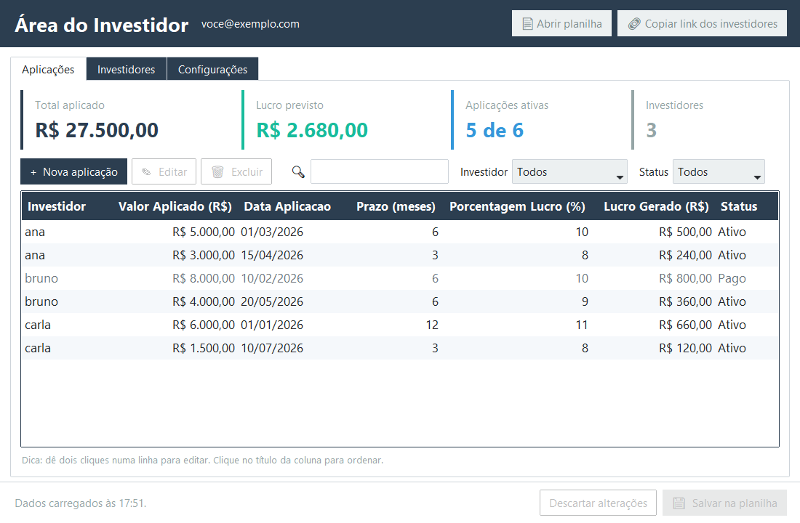
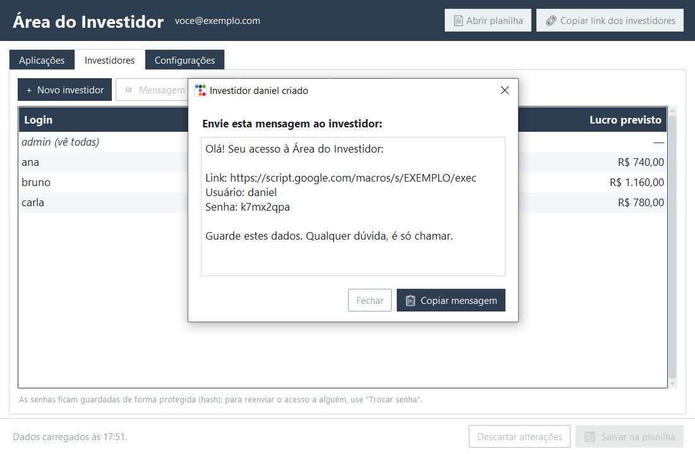
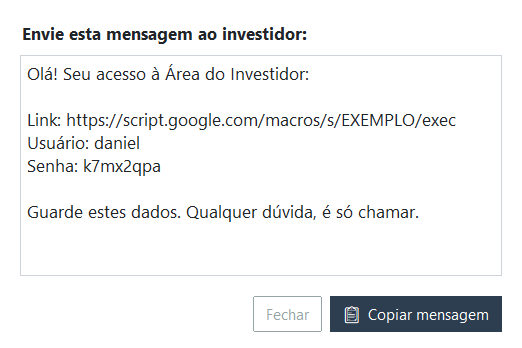
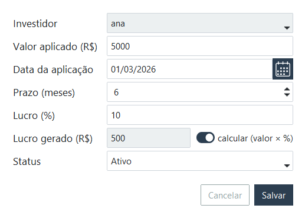
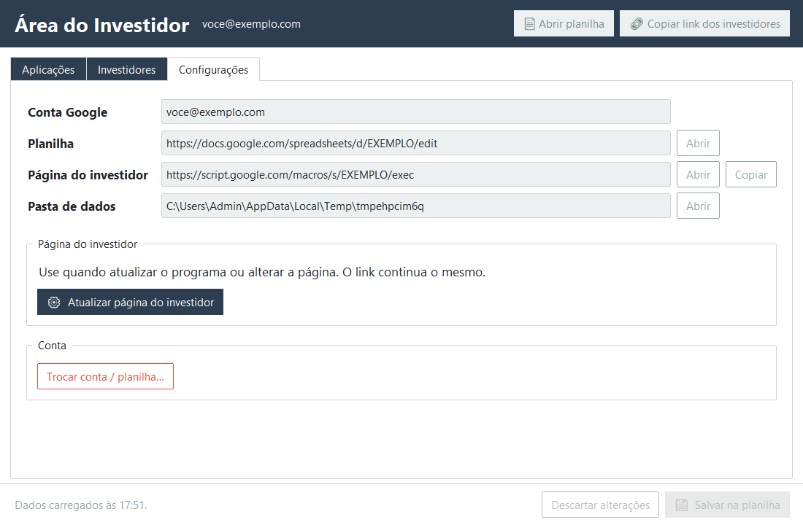

# Como usar no dia a dia

## A tela principal

- **Cartões no topo:** total aplicado, lucro previsto, aplicações ativas e número de investidores. Eles acompanham o filtro escolhido.
- **🔍 Busca, Investidor e Status:** filtram a tabela.
- Clique no **título de uma coluna** para ordenar.
- **Botões do topo:**
  - **Abrir planilha** abre o Google Sheets;
  - **Copiar link dos investidores** copia o endereço da página deles.

### Nada vai para o Google até você salvar
Você pode cadastrar, editar e excluir à vontade. Enquanto não salvar, aparece **● Alterações não salvas** no rodapé.
- **💾 Salvar na planilha** (ou **Ctrl+S**) envia tudo para o Google.
- **Descartar alterações** desfaz tudo e recarrega o que está na planilha.
- Se você fechar o programa sem salvar, ele avisa.

---

## Investidores

### Cadastrar um investidor
1. **+ Novo investidor**.
2. Digite o **login**: um nome curto, sem espaços (ex.: `joao.silva`).
3. A senha já vem gerada. Clique em **↻ Gerar outra** para trocar, ou digite uma sua (mínimo de 6 caracteres).
4. **Criar**: aparece a mensagem pronta com link, usuário e senha. Clique em **Copiar mensagem** e cole no WhatsApp ou no e-mail.
5. **Salvar na planilha**.

> 🔒 Por segurança, a senha **não fica guardada** em lugar nenhum, só a versão embaralhada (hash). Por isso a mensagem aparece na hora da criação.

### O investidor esqueceu a senha
Selecione o investidor → **🔑 Trocar senha** → copie a nova mensagem → **Salvar na planilha**.

### Remover um investidor
Selecione → **🗑 Excluir**. As aplicações dele continuam na planilha, mas ele não consegue mais entrar.

### O usuário `admin`
Na página dos investidores, quem entra como `admin` vê **as aplicações de todos**. Use para conferir. Ele não pode ser excluído, mas a senha pode ser trocada.

---

## Aplicações

- **+ Nova aplicação**: escolha o investidor na lista, digite o valor (`5000` ou `5.000,00`), escolha a data no calendário 📅 e informe o prazo e a %.
- **Lucro gerado:** com a chave *calcular* ligada, é calculado como `valor × % ÷ 100`. Desligue a chave para digitar outro valor.
- **Status:** `Ativo`, `Pago` ou outro que você digitar.
- **Editar:** dois cliques na linha, ou selecione e clique em **✎ Editar**.
- **Excluir:** selecione e clique em **🗑 Excluir** (ou aperte a tecla **Delete**).

> Primeiro cadastre o investidor na aba Investidores. Só depois ele aparece na lista da aplicação.

---

## O que o investidor vê
Ele abre o link, digita usuário e senha e vê uma tabela só com as aplicações dele. Funciona no celular. Os dados são lidos na hora da planilha: depois que você salva, basta ele atualizar a página.

Para testar, abra o link e entre com um dos seus investidores ou com o `admin`.

---

## Configurações

- **Atualizar página do investidor:** use depois de instalar uma versão nova do programa. **O link continua o mesmo.**
- **Trocar conta / planilha…:** desconecta do Google. Nada é apagado da planilha.
- **Pasta de dados:** onde ficam a sua credencial e a configuração (`%LOCALAPPDATA%\GerenciadorInvestidor`).

### Usar em outro computador
Instale o programa no outro computador e faça o assistente com a **mesma conta Google**. Depois escolha **"Usar planilha que já tenho"** → **Importar configuração (estado.json)…** e selecione o `estado.json` copiado da *Pasta de dados* do primeiro computador. Assim você mantém o mesmo link para os investidores.

> Se escolher "colar o link da planilha" em vez de importar, um **link novo** é criado para os investidores.

### Atualizar o programa
Baixe o `.msi` novo na [página de downloads](https://github.com/wercelyduarte/area-do-investidor/releases/latest) e instale por cima. Seus dados são mantidos. Depois clique em **Configurações → Atualizar página do investidor**.

---

## Problemas comuns

| Problema | Solução |
|---|---|
| *"Sem conexão com a internet"* | Confira a internet e tente de novo. Nada é perdido: as alterações continuam na tela até você salvar. |
| *"A planilha mudou"* ao salvar | Alguém editou direto no Google. **Não** substitui as alterações de lá: clique em *Não*, depois em **Descartar alterações** para recarregar, e refaça sua mudança. |
| *"Sua sessão do Google expirou"* | **Configurações → Trocar conta / planilha…** e conecte de novo. Se acontecer toda semana, faltou o [passo 4 do guia](GUIA_GOOGLE.md#passo-4--publicar-o-app). |
| O investidor diz "Usuário ou senha inválidos" | Confira se você clicou em **Salvar na planilha** depois de criar ou trocar a senha. Na dúvida, use **Trocar senha**. |
| O investidor não vê uma aplicação | Confira se a aplicação está no nome certo e se foi salva. Peça para ele atualizar a página (F5). |
| *"Sessão expirada"* na página do investidor | É normal depois de 6 horas. Basta entrar de novo. |
| O Windows bloqueou o instalador | **Mais informações → Executar assim mesmo**. |
| Outro erro | Anote a mensagem e [abra um chamado](https://github.com/wercelyduarte/area-do-investidor/issues). |
