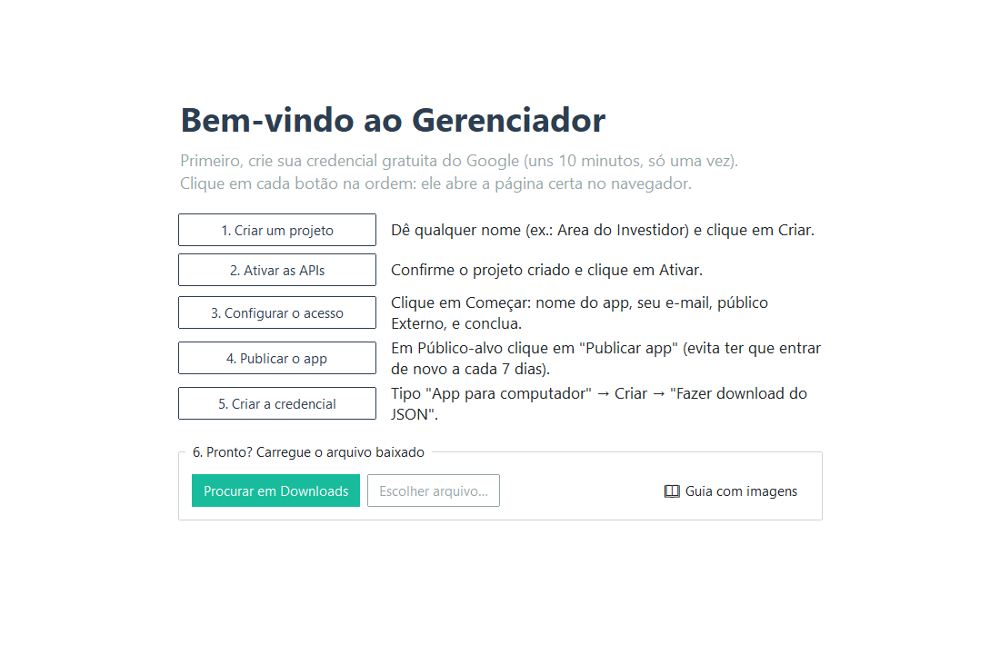
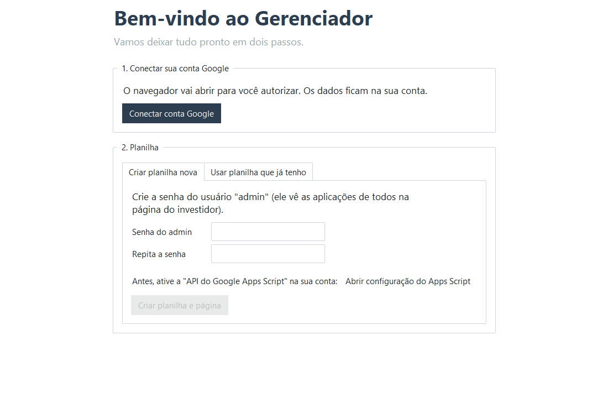

# Guia: criar sua credencial do Google (só uma vez)

O programa precisa de uma "credencial" do Google para mexer na **sua** planilha. Ela é gratuita e leva uns 10 minutos para criar.

> 💡 No programa, cada passo abaixo tem um botão que **abre a página certa**. Siga os botões na ordem e use este guia se ficar em dúvida.

Use a **mesma conta Google** em todos os passos, a mesma em que você quer que a planilha fique. Se o navegador tiver mais de uma conta, confira a foto no canto superior direito das páginas do Google.

---

## Passo 1 — Criar um projeto
Botão **"1. Criar um projeto"** (abre <https://console.cloud.google.com/projectcreate>).

- **Nome do projeto:** qualquer um, por exemplo `Area do Investidor`.
- **Local:** deixe como está ("Sem organização").
- Clique em **Criar** e espere uns segundos, até aparecer a notificação de que o projeto foi criado.

> Se for sua primeira vez no Google Cloud, ele pede para aceitar os termos de uso. Aceite. **Não precisa cadastrar cartão de crédito.**

## Passo 2 — Ativar as APIs
Botão **"2. Ativar as APIs"**.

- Confira se no topo aparece o projeto que você acabou de criar.
- Clique em **Próxima** e depois em **Ativar**. Isso ativa de uma vez: *Apps Script API*, *Google Sheets API* e *Google Drive API*.

## Passo 3 — Configurar o acesso (tela de consentimento)
Botão **"3. Configurar o acesso"**. Clique em **Começar** (*Get started*) e preencha:

| Campo | O que colocar |
|---|---|
| Nome do app | `Area do Investidor` |
| E-mail para suporte | o seu e-mail |
| Público-alvo | **Externo** (*External*) |
| Informações de contato | o seu e-mail |

Marque que concorda com a política e clique em **Criar**.

## Passo 4 — Publicar o app
Botão **"4. Publicar o app"** (página **Público-alvo** / *Audience*).

- Clique em **Publicar app** → **Confirmar**.

> ⚠️ **Não pule este passo.** Sem ele, o app fica em "modo de teste" e o Google desconecta você **a cada 7 dias**.
> Publicar aqui **não** deixa nada público: só significa que o login funciona sem prazo. Seus dados continuam só na sua conta.

## Passo 5 — Criar a credencial e baixar o arquivo
Botão **"5. Criar a credencial"**.

- **Tipo de aplicativo:** **App para computador** (*Desktop app*). ⚠️ Não escolha "Aplicativo da Web".
- **Nome:** qualquer um (ex.: `Gerenciador`).
- Clique em **Criar**.
- Na janela que aparece, clique em **Fazer download do JSON** (*Download JSON*). Vai baixar um arquivo com nome parecido com `client_secret_123...apps.googleusercontent.com.json`.

## Passo 6 — Carregar no programa
De volta ao programa, clique em **Procurar em Downloads**. Ele encontra o arquivo sozinho. Se você salvou em outro lugar, use **Escolher arquivo…**.

Pronto! Agora é só seguir o assistente:

1. **Conectar conta Google**: o navegador abre e aparece **"O Google não verificou este app"**. É esperado, porque o app é seu e foi criado agora. Clique em **Avançado** → **Acessar Area do Investidor (não seguro)** → marque todas as permissões → **Continuar**.
2. **Ative a API do Apps Script na sua conta**: clique no link *"Abrir configuração do Apps Script"* e ligue a chave **API do Google Apps Script**. É um clique só e serve para publicar a página dos investidores.
3. **Criar planilha e página**: defina a senha do `admin` e clique no botão. Leva uns 30 segundos.

---

## Deu algo errado?

| Mensagem | Solução |
|---|---|
| *"Esta credencial é do tipo Aplicativo da Web"* | Refaça o passo 5 escolhendo **App para computador**. |
| *"O Google recusou a autorização"* / `access_denied` | Faltou o **passo 4** (Publicar app). |
| *"A API do Apps Script está desativada"* | Abra <https://script.google.com/home/usersettings> e ligue a chave. |
| *"... API has not been used in project ..."* | Faltou o **passo 2**. Clique em "2. Ativar as APIs" de novo. |
| Escolhi a conta errada no navegador | No programa: **Configurações → Trocar conta / planilha…** |

Para começar a credencial do zero:
1. No programa, vá em **Configurações → Trocar conta / planilha…**.
2. Feche o programa e apague o arquivo `client_secret*.json` da pasta `%LOCALAPPDATA%\GerenciadorInvestidor`. Para abrir essa pasta, cole o endereço na barra do Explorador de Arquivos.
3. Abra o programa de novo.
